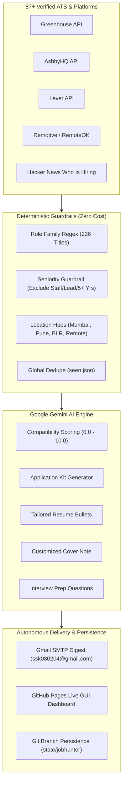

<div align="center">

# 🎯 Shubham's JobHunt
### **Autonomous AI Career Assistant & Executive Cloud Dashboard**

*Continuous Multi-Source Job Discovery · Gemini AI Candidate-Role Matcher · Automated Gmail Digests · Real-Time Mobile Web Dashboard*

[](https://github.com/shubhaammm08/Job-Hunt/actions/workflows/jobhunter.yml)
[](https://shubhaammm08.github.io/Job-Hunt/)
[](https://www.python.org/)
[](https://ai.google.dev/)
[-brightgreen)](#-zero-cost-cloud-infrastructure)
[](#-automated-testing)

<br/>

**[🌐 Live Executive Dashboard (Mobile & Web)](https://shubhaammm08.github.io/Job-Hunt/)** &nbsp;•&nbsp;
**[⚡ Cloud Workflows](https://github.com/shubhaammm08/Job-Hunt/actions)** &nbsp;•&nbsp;
**[💻 Local Quickstart](#-quickstart-local-development)** &nbsp;•&nbsp;
**[🏗️ Architecture](#️-system-architecture)**

</div>

---

## 📌 Executive Overview

**Shubham's JobHunt** is a 24/7 personal career engine engineered for **Shubham Sunil Kadam** (Computer Engineering, 2022–2026). It bridges the gap between massive job listings and high-probability career opportunities by executing fully autonomous cloud pipelines on GitHub Actions at **₹0/month infrastructure cost**.

The engine scans **87+ verified career endpoints** (Greenhouse, Ashby, Lever, Remotive, Hacker News, etc.), filters out 98%+ irrelevant or senior postings deterministically, scores candidate-job compatibility using **Google Gemini AI**, drafts bespoke application kits (tailored resume bullets, cover notes, skill-gap analysis, interview prep), and publishes the findings to a **live mobile-first web dashboard** and **Gmail**.

```
87+ ATS & Job Sources (2,000+ Postings)
          │
          ▼
Deterministic Prefilter (Seniority, Location, Freshness, Track)  [Free, Zero LLM]
          │  (~98% filtered out)
          ▼
Google Gemini AI Compatibility Scoring (0 – 10.0 Match)
          │
          ├───────────────────────────────────┬─────────────────────────────────┐
          ▼                                   ▼                                 ▼
📧 Gmail Daily Digest               📊 Interactive Web GUI              💾 Cloud Git State
 (Tailored Application Kits)         (Mobile & Desktop Dashboard)         (seen.json & tracker.csv)
```

---

## 🚀 Key Highlights & Features

### 1. 🤖 Autonomous Cloud Pipeline & Telegram AI Command Center
- **Daily JobHunter Autonomous Pipeline** (`jobhunter.yml`):
  - **Schedule:** Runs every morning at **9:00 AM IST** (`Asia/Kolkata`).
  - **Action:** Fetches fresh job openings across 87 sources, filters for junior / graduate roles in Mumbai, Pune, Bangalore, Hyderabad, Delhi NCR, and Global Remote, runs Gemini AI scoring, delivers high-match alerts directly to the Telegram Command Center (`@ShubhamJobHunt_Bot`), and commits deduplicated state.
- **Telegram AI Career Assistant** (`telegram_assistant.yml` & interactive daemon):
  - **Schedule:** Real-time 2-way interactive chat listener and automated 3-hour cloud sync.
  - **Action:** Instant `/top`, `/scan`, `/stats`, `/qa`, `/applied` commands, tailored recruiter pitch notes, and on-demand JD match scoring.

### 2. 📱 Executive Web & Mobile Dashboard
- **Hosted 24/7 on GitHub Pages:** [https://shubhaammm08.github.io/Job-Hunt/](https://shubhaammm08.github.io/Job-Hunt/)
- **Mobile-First Design:** Optimized for iPhone, Android, and tablets with `viewport-fit=cover`, safe-area insets, a compact **2×2 metrics banner**, and **1-touch thumb filter chips** (`🔥 High Fit`, `⭐ Recommended`, `📊 Data Analyst`, `🤖 AI/ML`, `🐍 Python Dev`, `⏳ Unapplied`).
- **Interactive Application Tracking:** 1-click **"Mark Applied"** toggle with local caching and REST API sync.
- **Embedded Digest & Source Health:** Review the daily curated email digest and monitor the health status of all 87 ATS adapters in real-time.

### 3. 🎯 12-Family Career Taxonomy (236 Targeted Titles)
Strictly calibrated for Computer Engineering graduates with expertise in **Python, SQL, Power BI, Machine Learning, and Junior AI development**:
- 📊 **Data Analyst / BI:** Junior Data Analyst, BI Developer, Product Analyst, Analytics Engineer
- 🤖 **AI / ML Engineering:** Junior ML Engineer, Computer Vision / NLP Associate, Applied AI Intern
- ⚡ **Generative AI & Agentic:** Prompt Engineer, LLM Evaluator, AI Automation Specialist
- 🐍 **Python & Backend:** Junior Python Developer, Backend Software Engineer, FastAPI / Django Developer

### 4. 🛡️ Resilient Git-Branch State Persistence
- Zero reliance on paid databases or external storage.
- Historical deduplication indexes (`seen.json`, `tracker.csv`, `summary_seen.json`) are stored and versioned on dedicated orphan branches (`state/jobhunter` and `state/inbox`).
- Built-in conflict resolution with three-way semantic JSON merging and pre-commit integrity checks to prevent state wipes or duplicate alerts.

---

## 🏗️ System Architecture



---

## 📊 Dashboard Preview

| Desktop View | Mobile Experience |
|:---:|:---:|
| Full-width dark mode control panel with multi-column sorting, source health indicators, and expandable AI fit rationale. | Touch-friendly thumb chips, compact 2x2 statistics grid, and 1-tap "Mark Applied" action buttons. |
| **URL:** `https://shubhaammm08.github.io/Job-Hunt/` | **Offline Ready:** Zero external CDNs, self-contained SVG icons. |

---

## 💰 Zero-Cost Cloud Infrastructure

Every component operates within 100% free-tier cloud quotas:

| Service | Purpose | Free Tier Allowance | Our Daily Utilization |
|---|---|---|---|
| **GitHub Actions** | Cron runner for JobHunter & Telegram Assistant | 2,000 min/month (Linux) | ~180 min/month (9%) |
| **GitHub Pages** | Static hosting for Executive Web GUI | Unlimited public sites | 100% Free |
| **Google Gemini API** | AI resume-to-job screening & drafting | Generous Free Tier | ~15 requests/day |
| **Telegram Cloud API** | Real-time 2-way bot commands & instant alerts | Unlimited free bot API | 100% Free |
| **GitHub Git Storage** | State persistence (`state/*` branches) | 1 GB storage limit | < 1 MB total |

---

## 💻 Quickstart: Local Development

### 1. Prerequisites
- Python 3.11 or 3.12
- Git

### 2. Clone and Setup Environment
```bash
git clone https://github.com/shubhaammm08/Job-Hunt.git
cd Job-Hunt

# Create and activate virtual environment
python -m venv .venv
.venv\Scripts\activate        # Windows
# source .venv/bin/activate   # macOS / Linux

# Install dependencies
pip install -r requirements.txt
```

### 3. Run the Test Suite (0 API Calls)
Verify parsers, filters, guardrails, and deduplication logic locally:
```bash
pytest -v
```

### 4. Launch the Executive Dashboard Locally
Double click `run_gui.bat` (Windows) or execute:
```bash
python -m gui.server --port 8080
```
Open **`http://localhost:8080`** in your browser.

### 5. Run a Mock Pipeline Test (No Secrets Needed)
Test the entire pipeline using bundled ATS fixtures without calling any external APIs:
```bash
python -m jobhunt run --mock --scorer keyword
```

### 6. Refresh Naukri Jobs
Naukri listings are normalized with the schema from
[Rockposedon/WebScraping](https://github.com/Rockposedon/WebScraping). The legacy
search API now requires reCAPTCHA, so a focused scan uses public search pages in
a guest browser:

```bash
python -m jobhunt naukri-import --live
```

The upstream project also publishes an archived text export. Import it on demand
with `python -m jobhunt naukri-import` (or `--file path/to/dataset.txt`); those
listings keep their original 2023 dates and are not shown as fresh.

---

## ⚙️ Configuration & Secrets

### GitHub Repository Secrets (Settings → Secrets and variables → Actions)

To enable autonomous cloud runs on GitHub Actions, configure the following secrets:

| Secret Name | Required By | Description | Example / Notes |
|---|---|---|---|
| `GEMINI_API_KEY` | JobHunter & Inbox Assistant | Google AI Studio Gemini API Key | `AIzaSy...` |
| `GMAIL_EMAIL` | Mailer & Inbox Assistant | Your Gmail address | `ssk080204@gmail.com` |
| `GMAIL_APP_PASSWORD` | Mailer & Inbox Assistant | 16-character Google App Password | `abcd efgh ijkl mnop` *(Requires Gmail 2FA)* |

*(Optional Secrets: `ANTHROPIC_API_KEY`, `GROQ_API_KEY` if testing other model providers).*

---

## 📁 Repository Structure

```
Job-Hunt/
├── .github/
│   └── workflows/
│       ├── jobhunter.yml           # Daily 9:00 AM IST JobHunter pipeline
│       ├── telegram_assistant.yml  # Telegram AI bot batch runner
│       └── deploy_dashboard.yml   # Automatic GitHub Pages dashboard builder
├── gui/
│   ├── index.html                  # Mobile-responsive Executive Dashboard
│   ├── server.py                   # Local zero-dependency Python REST server
│   └── digest.html                 # Rendered daily digest preview
├── jobhunt/
│   ├── fetch.py                    # Multi-ATS parallel fetcher & parsers
│   ├── prefilter.py                # Regex, location, and seniority guardrails
│   ├── roles.py                    # 12-family 236-role taxonomy definitions
│   ├── llm.py                      # Gemini AI scoring & application kit prompt
│   ├── providers.py                # Multi-provider LLM interface
│   ├── digest.py                   # Responsive HTML email digest template
│   ├── telegram.py                 # Instant Telegram alert dispatch & cards
│   ├── telegram_bot.py             # 2-way interactive Telegram bot engine
│   ├── store.py                    # State storage & CSV tracker exporter
│   └── cli.py                      # Command-line interface
├── tests/                          # Automated regression tests
├── build_mobile_gui.py             # Static asset bundler for GitHub Pages
├── run_gui.bat                     # 1-click Windows desktop launcher
├── run_bot.bat                     # 1-click Telegram bot listener launcher
├── config.yaml                     # Application settings & thresholds
├── companies.yaml                  # Curated list of verified ATS career boards
├── index.html                      # Root bundle for GitHub Pages
├── requirements.txt                # Python package dependencies
└── README.md                       # Project documentation
```

---

## 👨‍💻 Candidate Profile

- **Name:** Shubham Sunil Kadam
- **Education:** B.E. Computer Engineering (2022–2026)
- **Primary Focus:** Data Analyst · Junior AI / Machine Learning Developer · Python Developer
- **Target Hubs:** Mumbai, Powai, Pune, Bangalore, Hyderabad, Delhi NCR & Global Remote
- **Contact:** [ssk080204@gmail.com](mailto:ssk080204@gmail.com)

---

## 📜 License & Compliance

Distributed under the **MIT License**.

> **Note on Compliance:** This project reads only public, unauthenticated ATS endpoints (`boards.greenhouse.io`, `jobs.ashbyhq.com`, `jobs.lever.co`) intended for public job distribution. It strictly complies with terms of service and does not scrape protected or non-API platforms. Applications are never submitted automatically; the system solely aids in discovery and personalized drafting.
